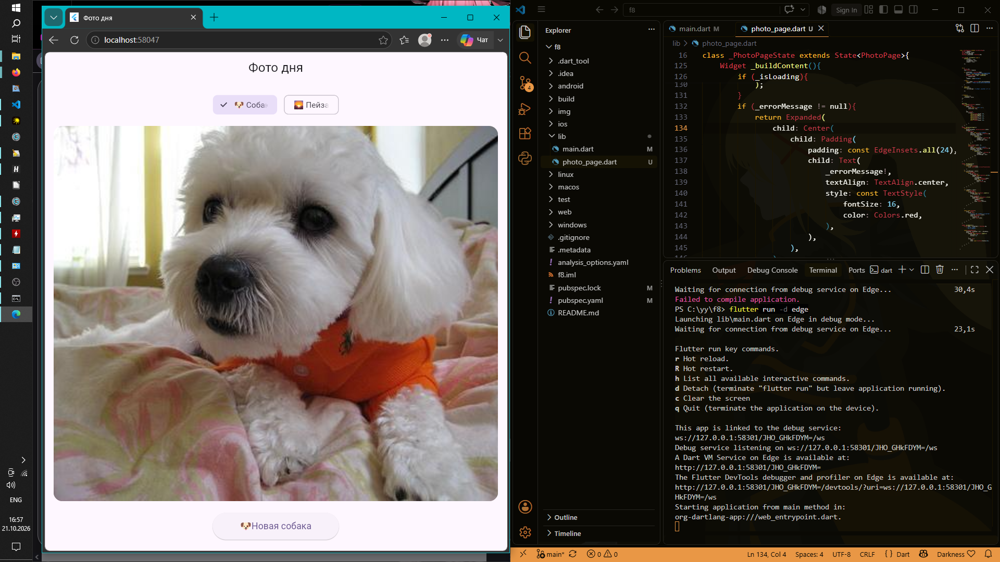

# Flutter 8 

Кроссплатформенное  приложение на Flutter, демонстрирующее работу асинхронного программирования в Dart. Приложение загружает случайные изображения (собак или пейзажей) из сети с использованием внешних API и отображает индикатор загрузки во время ожидания ответа. Также реализован альтернативный режим работы с локальными ресурсами без доступа к сети.

## Автор
* **Имя:** Чумаченко Михаил
* **Группа:** ИСП-242

## Стек технологий и версии
* **Фреймворк:** Flutter 3.47.7
* **Язык программирования:** Dart 3.13.5
* **Платформа сборки:** Web (Google Chrome)
* **Пакеты зависимостей:** `http` (для выполнения сетевых запросов)

## Скриншот работы приложения


## Запуск проекта
1. Клонируйте репозиторий:
   ```bash
   git clone <url>
   ```
2. Перейдите в корневую директорию проекта:
   ```bash
   cd f8
   ```
3. Загрузите необходимые зависимости и пакеты:
   ```bash
   flutter pub get
   ```
4. Запустите приложение в браузере:
   ```bash
   flutter run -d edge
   ```

## Что было изучено
1. **Асинхронное программирование в Dart:** Освоена концепция отложенных вычислений с помощью `Future`, а также написание читаемого кода через конструкцию `async/await`.
2. **Работа с сетью (HTTP-запросы):** Изучено подключение внешних зависимостей и отправка `GET`-запросов с использованием пакета `http`.
3. **Парсинг JSON-данных:** Освоена конвертация строковых ответов сервера в структурированные коллекции Dart (`Map`) с помощью `jsonDecode()`.
4. **Управление состояниями (State Management):** Реализовано динамическое переключение интерфейса (`StatefulWidget`) в зависимости от этапа асинхронной операции (загрузка, ошибка, успешное отображение).
5. **Локальные ассеты:** Настроено подключение и отображение статических файлов изображений через конфигурационный файл `pubspec.yaml`.

## Ответы на контрольные вопросы

### 1. Что такое `Future<T>`? Чем отличается от обычного возвращаемого значения?
`Future<T>` — это объект-обещание, который представляет результат асинхронной операции, завершающейся в будущем. Обычное возвращаемое значение доступно немедленно в момент выполнения функции и блокирует поток до его получения. `Future` возвращает управление сразу, а само значение (типа `T`) или ошибка появляются позже.

### 2. Что делает `await`? Блокирует ли он весь поток выполнения?
Ключевое слово `await` приостанавливает выполнение текущей асинхронной функции до тех пор, пока переданный `Future` не завершится результатом. При этом `await` **не блокирует** весь основной поток приложения: пока функция стоит на паузе, интерфейс остается отзывчивым, и другие части программы продолжают выполняться.

### 3. Зачем `setState()` вызывается дважды в `_fetchPhoto()`?
* **Первый вызов** происходит в самом начале функции, чтобы перевести интерфейс в состояние загрузки (`_isLoading = true`) и очистить прошлые данные. Это заставляет Flutter перерисовать экран и показать индикатор (`CircularProgressIndicator`).
* **Второй вызов** происходит в конце (после получения данных или поимки ошибки). Он сбрасывает флаг загрузки (`_isLoading = false`), прячет крутилку и отрисовывает полученную картинку или текст ошибки.

### 4. Почему кнопке передаётся `_fetchPhoto` без скобок, а не `_fetchPhoto()`?
Передача имени функции без скобок (`_fetchPhoto`) передает саму **ссылку на функцию** свойству `onPressed`, чтобы Flutter вызвал её исключительно тогда, когда пользователь нажмет на кнопку. Если написать скобки `_fetchPhoto()`, функция выполнится мгновенно прямо во время построения дерева виджетов (build), что приведет к зацикливанию перерисовок.

### 5. Чем `Image.network()` отличается от Image.asset()?
* **`Image.network()`** скачивает и отображает изображение из интернета по его URL-адресу в режиме реального времени.
* **`Image.asset()`** загружает изображение локально из ресурсов самого приложения (папки `assets`), которые предварительно упакованы в сборку проекта и не требуют сетевого соединения.
